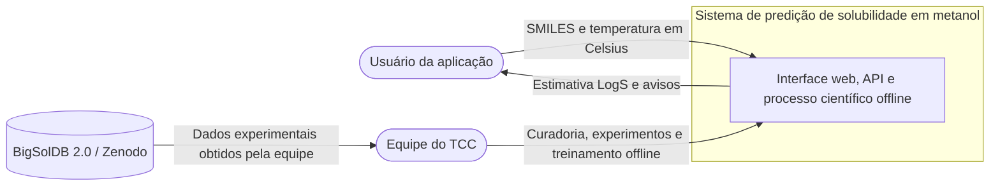

# Diagrama de contexto — C4 nível 1 (C28)

## Objetivo

Mostrar quem utiliza o protótipo, quem opera o processo científico offline e qual é a origem dos dados. O sistema estima **LogS(mol/L) em metanol puro**; não consulta bases externas durante uma predição.

## Diagrama

## Limites e responsabilidades

- **Usuário:** informa SMILES e temperatura; consulta estimativas, não medições experimentais.
- **Equipe do TCC:** prepara o subconjunto de metanol puro do BigSolDB 2.0, valida os modelos e gera o artefato offline.
- **BigSolDB 2.0:** fonte de dados experimentais (DOI: `10.5281/zenodo.15094979`); não é serviço consultado em tempo de inferência.
- **Sistema:** disponibiliza HTML, CSS e JavaScript pelo FastAPI e utiliza localmente o pipeline Ridge já treinado.

**Estado:** representa a implementação disponível após C27. Não inclui banco de dados, autenticação ou treinamento durante requisições HTTP.

## Detalhamento

- [Diagrama de contêineres](02-diagrama-conteineres.md)
- [Diagrama de componentes](03-diagrama-componentes.md)
- [Sequência de predição](04-diagrama-sequencia.md)
- [Fluxo científico](05-fluxo-cientifico.md)
