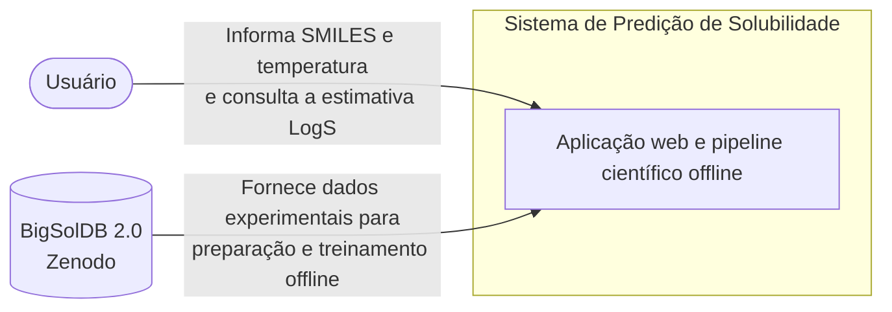

# Diagrama de Contexto — C4 Nível 1

## Objetivo

Representar o sistema de predição de solubilidade em metanol em seu contexto geral, identificando os usuários, a fronteira do sistema e sua relação com a fonte externa de dados.

O diagrama apresenta uma visão de alto nível, sem detalhar os componentes internos da aplicação.

## Diagrama

## Elementos representados

| Elemento | Descrição |
|---|---|
| Usuário | Pessoa que utiliza a aplicação para informar uma estrutura molecular e consultar uma estimativa de solubilidade. |
| Sistema de Predição de Solubilidade | Sistema desenvolvido pelo projeto, composto pela aplicação web e pelo processo científico de preparação e treinamento. |
| BigSolDB 2.0 | Fonte externa dos dados experimentais utilizados na construção dos modelos. |

## Relacionamentos

**Usuário → Sistema:** o usuário informa uma estrutura molecular em formato SMILES e uma temperatura. O sistema apresenta uma estimativa de solubilidade em metanol.

**BigSolDB 2.0 → Sistema:** a base fornece os registros experimentais utilizados na auditoria, curadoria e treinamento dos modelos.

A obtenção dos dados ocorre durante a preparação científica, não durante as requisições de predição.

## Observações

- O solvente considerado pelo sistema é exclusivamente o metanol puro.
- A aplicação disponibiliza estimativas de LogS (mol/L).
- O treinamento dos modelos é realizado offline.
- O sistema não realiza consultas ao BigSolDB durante uma predição.
- O diagrama representa a arquitetura planejada, que será detalhada conforme a implementação evoluir.
