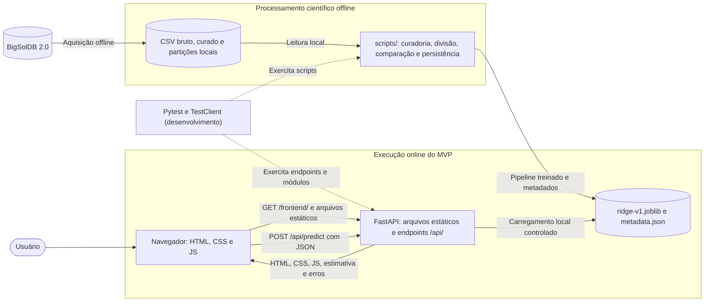

# Diagrama de contêineres — C4 nível 2 (C28)

## Objetivo

Separar o **uso online** (navegador e FastAPI) dos **scripts científicos offline**. O navegador obtém os arquivos do frontend e chama a API pela **mesma origem HTTP**.

## Diagrama

## Componentes técnicos e responsabilidades

| Contêiner | Tecnologia | Responsabilidade |
|---|---|---|
| Frontend no navegador | HTML, CSS e JavaScript nativos | Formulário, `fetch`, estados de carregamento, resultado e erro |
| API e arquivos estáticos | Python, FastAPI e Pydantic | `GET /frontend/`, `POST /api/predict`, `GET /api/health` e `GET /api/model-info` |
| Scripts offline | Python, Pandas, RDKit e scikit-learn | Preparar dados, dividir por molécula, comparar modelos e persistir o Ridge |
| Dados locais | Arquivos CSV fora do Git | Fonte bruta, curadoria e divisão de treino/teste |
| Artefatos locais | Joblib e JSON | Pipeline `ridge-v1` e metadados de proveniência/compatibilidade |
| Testes | Pytest e FastAPI TestClient | Verificar os contratos e os comportamentos, fora do fluxo de produção |

Os arquivos `artifacts/ridge-v1.joblib` **não são versionados por padrão**; `artifacts/ridge-v1.metadata.json` registra as informações e o SHA-256 do artefato gerado no C23. O JSON não é um substituto para o binário.

**Não há banco de dados nem microsserviços.** O BigSolDB 2.0 não é consultado a cada requisição; toda inferência utiliza o artefato local.

## Detalhamento

- [Contexto](01-diagrama-contexto.md)
- [Componentes da API](03-diagrama-componentes.md)
- [Sequência de predição](04-diagrama-sequencia.md)
- [Fluxo científico](05-fluxo-cientifico.md)
