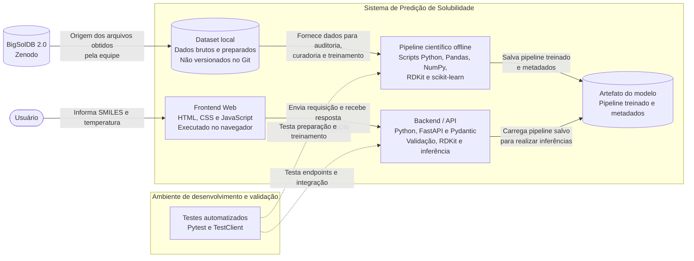

# Diagrama de Contêineres — C4 Nível 2

## Objetivo

Representar os principais elementos técnicos do sistema de predição de solubilidade em metanol, identificando suas responsabilidades, tecnologias previstas e relacionamentos.

O diagrama diferencia o fluxo de treinamento científico, executado offline, do fluxo de inferência, executado durante a utilização da aplicação.

## Diagrama

## Elementos representados

| Elemento | Tecnologia | Responsabilidade |
|---|---|---|
| Frontend Web | HTML, CSS e JavaScript | Receber SMILES e temperatura e apresentar os resultados. |
| Backend / API | Python, FastAPI e Pydantic | Validar as requisições, coordenar o processamento químico e executar as predições. |
| Pipeline científico | Python, Pandas, NumPy, RDKit e scikit-learn | Preparar os dados, extrair atributos, treinar e avaliar os modelos. |
| Dataset local | Arquivos CSV ou outros formatos apropriados | Armazenar os dados originais e preparados. |
| Artefato do modelo | Pipeline serializado e metadados | Armazenar o modelo treinado utilizado pela API. |
| Testes automatizados | Pytest e TestClient | Verificar o funcionamento dos módulos, endpoints e integrações. |

## Fluxos principais

### 1. Fluxo de utilização da aplicação

1. O usuário informa uma estrutura molecular e a temperatura no frontend.
2. O frontend envia os dados para o backend por meio de uma requisição HTTP.
3. A API valida os dados recebidos.
4. O processamento químico utiliza o RDKit para validar o SMILES e extrair os descritores moleculares.
5. O serviço de predição utiliza o pipeline previamente treinado.
6. A API devolve a estimativa ao frontend.

### 2. Fluxo científico offline

1. A equipe obtém os dados do BigSolDB 2.0.
2. Os arquivos são armazenados localmente.
3. Os scripts científicos realizam a auditoria e a preparação dos registros.
4. Os descritores moleculares são calculados.
5. Os modelos são treinados e avaliados.
6. O pipeline selecionado e seus metadados são salvos como artefatos.

### 3. Fluxo de testes

Os testes automatizados verificam os módulos científicos, os endpoints da API e a integração dos componentes.

Os testes pertencem ao ambiente de desenvolvimento e validação, não ao fluxo de execução normal da aplicação.

## Decisões arquiteturais representadas

- O frontend e o backend possuem responsabilidades separadas.
- O backend não realiza treinamento durante as requisições.
- O pipeline científico é executado offline.
- Os dados são armazenados localmente, sem banco de dados.
- O modelo treinado é persistido em um artefato.
- A API reutiliza o pipeline salvo durante a inferência.
- O processamento de atributos deve ser consistente entre treinamento e inferência.

## Observações

O dataset e os artefatos são representados como armazenamento de arquivos, não como bancos de dados.

A representação do pipeline e dos módulos internos é de alto nível. O detalhamento dos componentes do backend será apresentado em um diagrama específico posteriormente.

Os elementos representam a arquitetura planejada e deverão ser atualizados conforme a implementação real.
