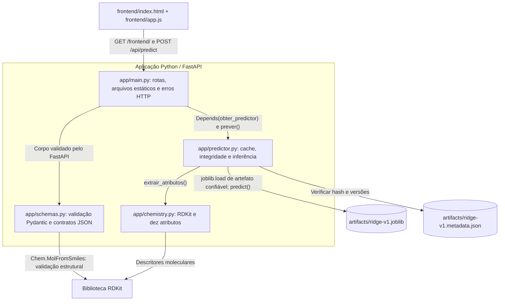

# Diagrama de componentes — backend (C28)

## Objetivo

Detalhar os módulos realmente existentes após o C27 e seus limites de responsabilidade. Esse é um detalhamento do contêiner **FastAPI**, não um novo serviço ou banco de dados.

## Diagrama

## Correspondência com o código

| Componente | Responsabilidade observada |
|---|---|
| [`app/main.py`](../../app/main.py) | Entrega `/frontend/`, implementa `GET /api/health`, `GET /api/model-info` e `POST /api/predict`; mapeia erros para HTTP |
| [`app/schemas.py`](../../app/schemas.py) | Valida SMILES e temperatura, converte Celsius para Kelvin e define `PredictRequest`, `PredictResponse` e `ErrorResponse` |
| [`app/chemistry.py`](../../app/chemistry.py) | Extrai nove descritores moleculares mais `Temperature_K`; compartilha `FEATURE_NAMES` com treino e inferência |
| [`app/predictor.py`](../../app/predictor.py) | Carrega o pipeline salvo, verifica metadados e integridade, faz predições finitas e acrescenta avisos |
| [`frontend/app.js`](../../frontend/app.js) | Envia `POST /api/predict` e apresenta resultado/erro sem inserir HTML não confiável |

A checagem do SHA-256 demonstra **integridade em relação aos metadados**, não autenticidade por si só. Um arquivo Joblib de origem desconhecida não deve ser carregado.

`PredictRequest` aceita ausência de temperatura como campo opcional do schema, mas o endpoint **rejeita a omissão com HTTP 422**: não existe temperatura padrão automática aprovada. Temperatura fora da faixa observada no treino gera **aviso de extrapolação**, não garantia de confiabilidade.

## Referências

- [Contêineres](02-diagrama-conteineres.md)
- [Sequência de predição](04-diagrama-sequencia.md)
