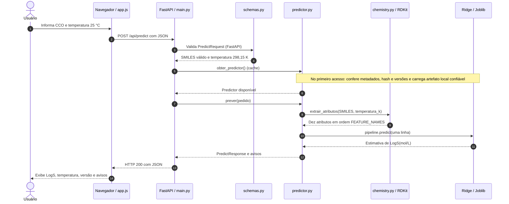
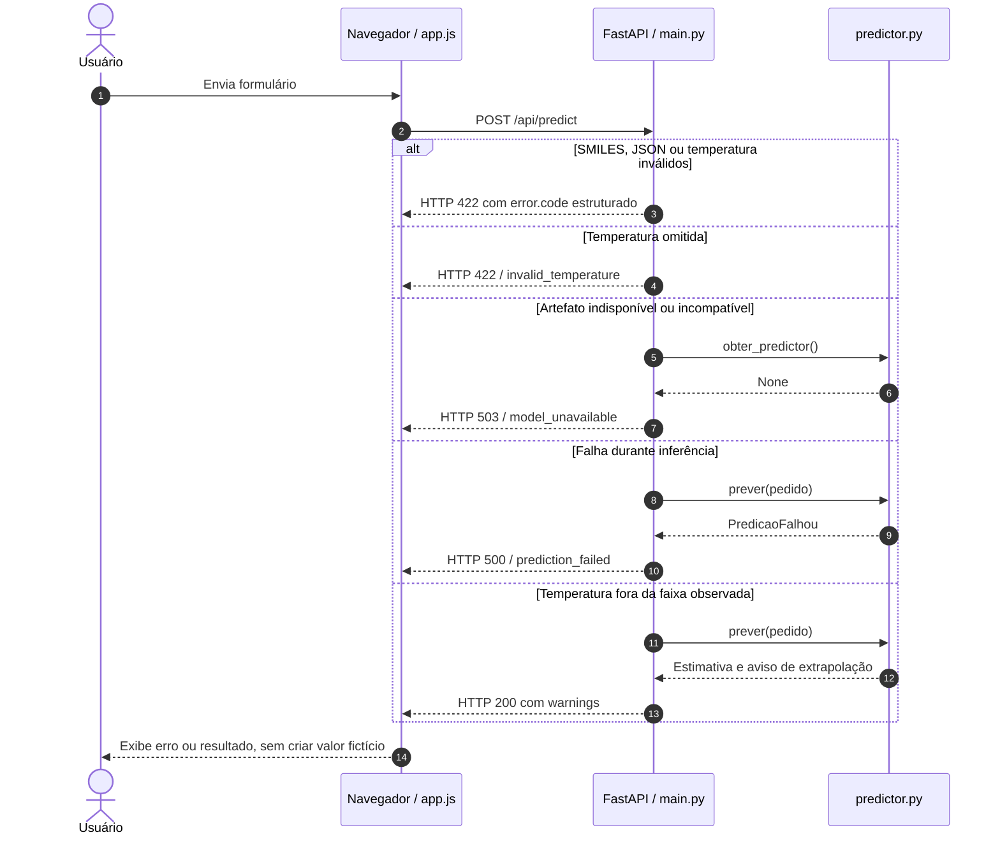

# Diagrama de sequência — predição HTTP (C28)

## Fluxo bem-sucedido

O valor numérico obtido depende do **artefato local**. O backend não consulta BigSolDB nem executa `fit()` durante essa sequência. A validação inicial de SMILES no schema também utiliza RDKit.

## Caminhos de erro e comportamento de interface

A interface bloqueia campos vazios/temperatura impossível antes de enviar; SMILES sintaticamente inválidos podem chegar à API e são rejeitados pelo schema. Ao editar os campos enquanto há uma chamada pendente, `AbortController` cancela a requisição anterior e impede mostrar resultados desatualizados.

| HTTP | Significado |
|---|---|
| 200 | Estimativa e avisos, incluindo extrapolação quando aplicável |
| 422 | `invalid_smiles`, `invalid_temperature` ou `invalid_request` |
| 503 | `model_unavailable` |
| 500 | `prediction_failed` |

O exemplo `CCO` é uma verificação funcional, **não uma avaliação de acurácia experimental**.

## Referências

- [Componentes da API](03-diagrama-componentes.md)
- [Contrato da API](../contrato-api.md)
