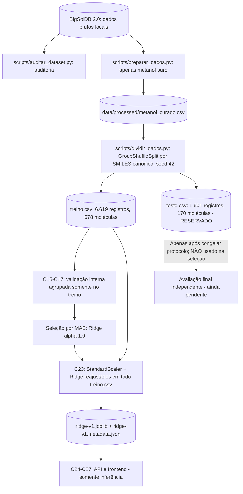

# Fluxo científico — curadoria, seleção e persistência (C28)

## Objetivo

Representar os procedimentos offline realizados até o C23 e a separação entre **treino/validação interna** e **teste final reservado**, evitando sugerir que as métricas atuais vieram do teste final.

## Diagrama

## Resultados efetivamente registrados

| Etapa | Evidência |
|---|---|
| Fonte | BigSolDB **2.0**, DOI `10.5281/zenodo.15094979` |
| Curadoria | Apenas observações de metanol puro; alvo `LogS(mol/L)` |
| Divisão C14 | 6.619 registros de treino (678 moléculas), 1.601 de teste (170 moléculas), sem moléculas compartilhadas |
| Validação interna do treino | 5.285 registros de ajuste e 1.334 de validação, separados por molécula |
| Seleção | Ridge teve MAE ≈ 0,797167, RMSE ≈ 0,978122 e R² ≈ 0,213921 na validação interna |
| Persistência C23 | Novo ajuste com os 6.619 registros do treino, versão `ridge-v1`, metadados e SHA-256 |
| Avaliação final | **Não realizada** neste fluxo; `teste.csv` permanece reservado |

## Limitações de interpretação

1. **Seleção do modelo:** a comparação entre DummyRegressor, Ridge e Random Forest ocorreu na mesma validação interna agrupada; ela não é avaliação externa.
2. **Reajuste final:** o Ridge salvo foi ajustado em **todo o conjunto de treino**, sem usar `teste.csv`.
3. **Métricas de validação:** pertencem ao experimento interno **anterior ao reajuste completo**. Não representam o desempenho do artefato em moléculas de teste inéditas.
4. **Generalização:** um R² de cerca de 0,214 indica poder explicativo limitado; não deve ser descrito como alta precisão.
5. **Consistência química:** `app/chemistry.py` gera os dez atributos (nove descritores mais temperatura em Kelvin) tanto no treinamento quanto na inferência.
6. **Rastreabilidade:** o artefato binário permanece local; os metadados versionados identificam a fonte, a ordem de atributos, as versões das bibliotecas e os hashes.
7. **Próxima avaliação:** somente depois de formalizar e congelar o protocolo, executar a avaliação final no conjunto reservado, sem usá-lo para escolher ou reajustar o modelo.

## Referências de implementação

- [`scripts/preparar_dados.py`](../../scripts/preparar_dados.py)
- [`scripts/dividir_dados.py`](../../scripts/dividir_dados.py)
- [`scripts/treinar_modelos.py`](../../scripts/treinar_modelos.py)
- [`scripts/avaliar_modelos.py`](../../scripts/avaliar_modelos.py)
- [`scripts/persistir_modelo.py`](../../scripts/persistir_modelo.py)
- [`app/chemistry.py`](../../app/chemistry.py)
- [Contêineres](02-diagrama-conteineres.md)
