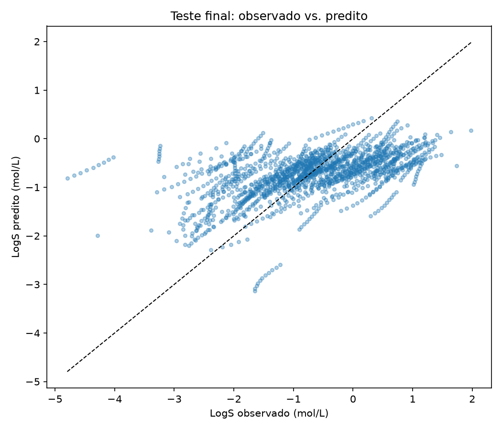
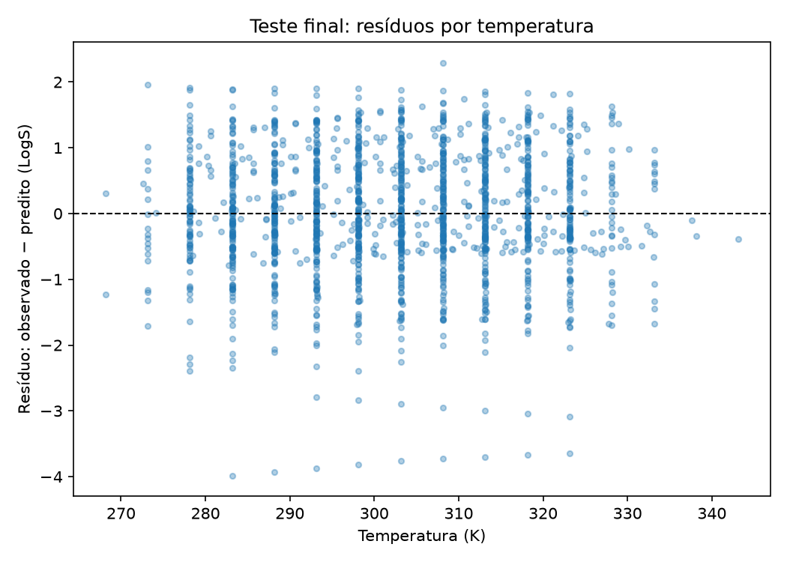

# C30 — Avaliação final independente por molécula

**Modelo congelado:** `ridge-v1`. **Fonte:** BigSolDB 2.0, metanol puro.
**Data UTC:** 2026-11-22. **Alvo:** LogS(mol/L).

> Esta é uma avaliação em **teste retido por molécula**, do mesmo banco de dados.
> Não é validação externa em outra fonte, nem prova de aplicabilidade universal.
> **Não reajustar o modelo nem escolher hiperparâmetros com base nestes resultados.**

## Rastreabilidade da partição e do artefato

- Treino C14: 6619 registros / 678 moléculas.
- Teste final C14: 1601 registros / 170 moléculas.
- Moléculas compartilhadas: 0.
- Source_Row compartilhados: 0.
- SHA-256 treino: `0f272a13c2a7c5f0469abf64f098cceec2c82a0c586eae6def1c7491752178d9`.
- SHA-256 teste: `3a93f9e6f37d890971004527020c862574e08ea6e505e1b04afc99e485d8d99a`.
- SHA-256 artefato: `f362ca5d4b01e834901bb446a5029b1f9fb7a1636c7e87374dfd1fbb5e96bf5f`.

## Métricas no teste final (nunca usadas para seleção)

| Métrica | Teste final C30 | Validação interna C23 (referência, outra amostra) |
|---|---:|---:|
| MAE (LogS) | 0.726303 | 0.797167 |
| RMSE (LogS) | 0.923927 | 0.978122 |
| R² | 0.255850 | 0.213921 |

**Atenção:** as métricas da validação interna referem-se a outro ajuste
sobre uma partição interna do treino. Elas não são métricas do pipeline
reajustado no conjunto completo de treino.

A avaliação final do modelo Ridge apresentou MAE de 0,7263, RMSE de 0,9239 e R² de 0,2559 no conjunto reservado de 1.601 registros, correspondentes a 170 moléculas não presentes no treinamento. Embora as métricas tenham sido numericamente mais favoráveis do que as observadas na validação interna, essa diferença não deve ser interpretada como evidência de melhoria do modelo, pois as avaliações utilizaram diferentes amostras e ajustes. O valor de R² indica capacidade preditiva limitada, reforçando a necessidade de cautela ao utilizar o modelo para estimativas de solubilidade de compostos inéditos. O viés médio de 0,0231 LogS sugere uma pequena subestimação média, considerando a definição de resíduo como valor observado menos valor previsto. Todas as observações do teste estavam dentro da faixa de temperatura do treinamento, impossibilitando uma avaliação empírica do desempenho em extrapolação térmica.

## Resíduos e heterogeneidade

- Viés médio (observado − predito): 0.023091 LogS.
- Mediana do erro absoluto: 0.586178 LogS.
- Percentil 90 do erro absoluto: 1.455450 LogS.
- MAE médio por molécula (mesmo peso por molécula): 0.753855 LogS.

Faixas definidas **antes de observar o teste** a partir dos limites
mínimo e máximo de temperatura do treino do C23:

| Faixa | Registros | MAE (LogS) |
|---|---:|---:|
| abaixo do treino | 0 | não calculável |
| dentro da faixa do treino | 1601 | 0.726303 |
| acima do treino | 0 | não calculável |

## Limitações científicas e de interpretação

1. O teste foi separado por SMILES canônico, reduzindo vazamento de identidade
   molecular; isômeros, análogos e famílias químicas relacionadas ainda podem
   compartilhar padrões, e podem existir outras fontes de dependência dos dados.
2. Os registros podem representar medições repetidas; o MAE padrão pondera
   registros, enquanto o MAE médio por molécula pondera moléculas igualmente.
3. SMILES e descritores 2D, junto à temperatura, não capturam necessariamente
   todos os fatores experimentais que determinam a solubilidade.
4. A qualidade, cobertura química, unidades e condições de medição do BigSolDB
   limitam a generalização; resultados neste banco não equivalem a validação externa.
5. Erros por faixa de temperatura são descritivos; faixas com poucas observações
   não autorizam conclusões robustas. Dentro da faixa de treino também há
   possibilidade de extrapolação estrutural.
6. O algoritmo é Ridge linear com padronização; não há intervalos de incerteza
   preditiva individuais nem garantia de precisão para moléculas inéditas.
7. Inspecionar este teste **não autoriza reajustar** a versão `ridge-v1`.
   Uma nova avaliação após ajustes exigiria outro conjunto independente.

O JSON inclui apenas métricas agregadas. CSVs, SMILES individuais e
predições linha a linha não são exportados.
